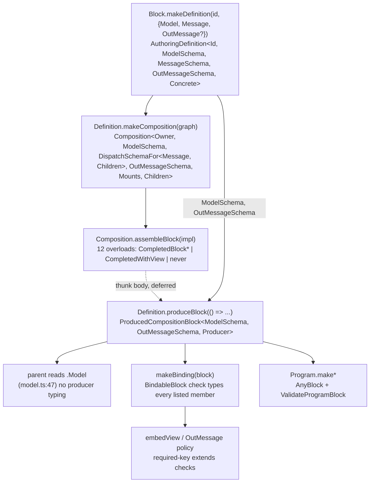

# Grounding: completed Block shapes, Definitions, and gates for a hardened `produceBlock` (#1737)

Repository paths are relative to the prototype checkout unless marked TIP:

- BASE: `/tmp/claude-10604308/-home-mrwe1-office-begasoft-ch-projects-foldkit-foldkit/962e359b-1e5f-438a-81f8-73fb99a793e4/scratchpad/wt-base` (65d1cd9c plus prototype d8626087d).
- TIP: `/tmp/claude-10604308/-home-mrwe1-office-begasoft-ch-projects-foldkit-foldkit/962e359b-1e5f-438a-81f8-73fb99a793e4/scratchpad/wt-tip` (65d1cd9c plus 9a5f9307).

`packages/foldkit/src` is identical in both checkouts apart from the prototype (`define.ts`, `produced.ts`, `public.ts`), so `definition.ts`, `binding.ts`, `bindChild.ts`, `keyedBinding.ts` and runtime line numbers apply to both. 9a5f9307 touches only Website Schema re-exports (`packages/website/src/model.ts` reads `Ui.Model` instead of `UiBlock.Model`), the new `packages/foldkit/declaration-tests/schema-boundary*` fixtures, their `checks` entry, and the type-performance README.

Evidence files live in the scratchpad (`/tmp/claude-10604308/-home-mrwe1-office-begasoft-ch-projects-foldkit-foldkit/962e359b-1e5f-438a-81f8-73fb99a793e4/scratchpad/`). Below, `SP/` abbreviates that absolute directory; expand it before opening a file.

## Overview

A Foldkit Block is authored in three steps. `Block.makeDefinition(id, { Model, Message, OutMessage? })` fixes identity and Schemas. `Definition.makeComposition({ mounts, bindings })` adds the child and Mount graph. `Composition.assembleBlock({ init, update, view?, ... })` resolves one of twelve generic overloads and returns a completed Block. A parent that only wants the child's Model Schema (`uiPages: UiBlock.Model` in `packages/website/src/model.ts:47` on BASE) still forces TypeScript to resolve that whole overloaded generic call, because the type of `UiBlock` is the call's return type.

The prototype wraps the call in a thunk: `UiDefinition.produceBlock(() => UiComposition.assembleBlock({ init, update, view }))` (`packages/website/src/page/ui/block.ts`). `produceBlock` is `<Producer>(produce: Producer) => ProducedCompositionBlock<ModelSchema, OutMessageSchema, Producer>` (`packages/foldkit/src/block/define.ts:171-176`). Because `Producer` is a naked, unconstrained type parameter, TypeScript infers it from the arrow function without computing the arrow's return type. `Model` on the result is the Definition's own `ModelSchema` type parameter, so reading it never types the thunk body. Every other member is a deferred conditional, `ProducedMember<Producer, Key>`, that types the thunk only when read. On the same host, this cut `changedUrl.hover.postWhitespace` from 2990 ms to 1312 ms (median of 3 fresh native TS 7.0.2 sessions).

The prototype has three holes the hardening must close:

1. It always picks a view shape, so viewless producers (15 of 132 Block sites, including Query) get a wrong `[DefaultViewTypeId]` member.
2. It accepts a producer that returns another Definition's Block, at the type level and at runtime.
3. No gate, fixture or lint rule knows `produceBlock` exists.

The deferral is fragile. Any constraint, contextual signature, or selector that looks at `Producer`'s return type re-introduces the eager computation the prototype removed.

## Key Concepts

- **Completed Block shapes.** Four interfaces in `packages/foldkit/src/block/definition.ts`, each `BlockContract` (18 members, `:2001`) plus two modifier choices:
  - `CompletedBlockWithViewAndOutMessage` (`:2038`): required `OutMessage`, required `[DefaultViewTypeId]`.
  - `CompletedBlockWithView` (`:2069`): `NoOutMessage` (`OutMessage?: never`, `:1168`), required `[DefaultViewTypeId]`.
  - `CompletedBlockWithOutMessage` (`:2101`): required `OutMessage`, `NoDefaultView` (`[DefaultViewTypeId]?: never`, `:1172`).
  - `CompletedBlockWithoutViewOrOutMessage` (`:2133`): both `?: never`.

  `CompletedBlock<...>` (`:2302`) chooses among them. The OutMessage arm keys on the Definition's `OutMessageSchema`. The view arm keys on `ImplementationValue extends Readonly<{ view: AnyAuthoredView }>`. `CompletedWithView<DefinitionValue, ImplementationValue>` (`:2238`) is returned by exactly one overload, the one UiBlock hits. `CompletedWithViewAndOutMessage` (`:2209`) is never returned by `assembleBlock`; `@foldkit/ui` uses it only as an explicit annotation. `Block<...>` (`:2268`) is an intersection alias returned by `replaceEffectsLayer`, `provideHandlers`, and used for Query's type.
- **`AnyBlock`** (`definition.ts:2428-2449`). The structural bound for Programs and the server. Everything is required except `__blockHandlerRequirements?: unknown`, `[DefaultViewTypeId]?: AnyAuthoredView` and `OutMessage?: AnySchema`.
- **`BindableBlock`** (`binding.ts:339`). The bound for `makeBinding` / `bindChild`. It has no `[DefaultViewTypeId]`, `makeView`, `replaceEffectsLayer`, `provideHandlers` or `[LocalEffectsLayerTypeId]`, and has optional `OutMessage?` and `__blockHandlerRequirements?`.
- **`DefaultViewTypeId`** (`defaultView.ts:4`). A `declare const` unique symbol, so the member is type-only. The runtime default view lives in a WeakMap keyed by the Block object (`registerDefaultView`, `defaultViewOf`). `DefaultViewOf<B>` (`:7`) infers from a *required* key.
- **`LocalMountsTypeId`, `LocalEffectsLayerTypeId`.** Real runtime symbols set on the Block (`definition.ts:4188, 4197`). `__blockHandlerRequirements` is phantom: required in `BlockContractFields`, absent at runtime. `provideHandlers` has the type `never` when `hostHandlers` is empty (`definition.ts:1906-1909`).
- **Owner.** `Owner<Id, Concrete>` (`owner.ts:6-11`) is `{ id; namespace; token: object; [ConcreteOwnerTypeId]: Concrete }`. `token` is an unbranded `object`. Two Definitions with the same literal id have identical owner types, and any two `Owner<string, false>` are mutually assignable. At runtime one `makeNamespace` call creates one owner object, which every `Namespace.makeDefinition` on it shares (`named.ts:563-627`, `define.ts:250-286`).
- **`AuthoringDefinition`** (`define.ts:142-177`). The type returned by `Block.makeDefinition` and `Namespace.makeDefinition`. It is the only type with `produceBlock`. `Id` and `Concrete` are in scope there but are not passed to `ProducedCompositionBlock`. `Block.Definition` (`definition.ts:3318`), `Base` (`:3549`) and `Composition` (`:3418`) have no `produceBlock`.
- **`ProducedMember<Producer, Key>`** (`produced.ts:10-18`). Yields `InvalidBlockProducer` when `Producer` is `never`, is not a function, returns `never`, or lacks `Key`; otherwise `Completed[Key]`. It matches `(...args: ReadonlyArray<any>) => infer Completed`, so thunks with required parameters pass.
- **Deferral.** The micro-reproduction (`SP/repro/lib.ts`, `SP/repro/measure.mjs`) measured an unconstrained thunk at 5 instantiations against about 255k for the eager call. A `F extends () => Impl` constraint or a contextually typed `make: () => Impl` parameter is eager again. The issue attributes this to `contextuallyCheckFunctionExpressionOrObjectLiteralMethod` computing the body's return type when a contextual signature exists.

## How It Works

### Runtime construction

1. `Block.makeDefinition(id, cfg)` (`define.ts:290-416`) calls `makeNamespace(id).makeDefinition(cfg)`. So every public Definition, literal or not, goes through `makeNamespace` and receives the prototype's `produceBlock`.
2. `makeNamespace` (`define.ts:250-286`) calls `makeAuthoringContext(id)` (`named.ts:563`), which runs `assertBlockId`, builds `owner = makeOwner(id)` with `token: {}`, and returns `Object.assign(owner, { define, makeCommand, ... })`. The owner object is also the authoring context.
3. `namespace.makeDefinition(contracts)` runs `assertDefinitionContracts`, then `base = authoring.define(contracts)`, which is `makeBaseDefinition(owner, contracts)` (`definition.ts:4309`). It returns a **new spread object** `{ ...base, ...primitives, makeComposition, produceBlock }` (`define.ts:282`). The user-held Definition is therefore not the internal `base`.
4. Inside `makeBaseDefinition`, an inner runtime `makeDefinition(owner, config)` (`definition.ts:3956`) is built first. `makeComposition(graph)` builds a second runtime definition, `makeDefinition(owner, { ...config, ...graph }, base)`, passing the inner definition as `authoring` (`:3966`), and returns a `publicComposition` registered in the `compositions` WeakSet (`:131`).
5. `assembleBlock` (`definition.ts:4087-4211`) builds `{ owner, Model: config.Model, Message: dispatchMessage, OutMessage?, makeView, mounts, [LocalMountsTypeId], bindings, init, update, operations, subscriptions, managedResources, EffectsLayer, hostHandlers, [LocalEffectsLayerTypeId], replaceEffectsLayer, provideHandlers }`. It then registers four WeakMaps keyed by that object: `registerRuntimeBindings`, `registerDefaultView`, `localChannels`, and `registerBlockHostIdentities` (`:4201-4208`). `replaceEffectsLayer` and `provideHandlers` call `assembleBlock` again in the same closure, so their Blocks keep the same owner and authoring.
6. Prototype `produceBlock = (produce) => produce()` (`define.ts:280`) closes over nothing and returns the identical object, so all four WeakMap registrations stay valid (confirmed by `SP/how/probe/runtime.mjs`).

What a Block records about its Definition at runtime: `block.owner` (shared per namespace), `block.Model === config.Model`, `block.OutMessage === config.OutMessage`. `block.Message` is identity-equal to the Definition's `Message` only when the Composition registers no generated child envelopes; otherwise `makeDispatchSchema` returns a new Schema (`childEnvelope.test.ts:50, 86`). `ChildInitContext` is not on the Block. No WeakMap maps a Block or a Composition back to its Definition.

The existing runtime "same Definition" precedent is `assertBindingParentContracts` (`composition.ts:218-229`). It compares `ownerToken`, `Model`, `Message`, `OutMessage` and `ChildInitContext` by identity and throws "belongs to a different parent Definition contract".

### Type flow and where the producer gets typed

`Definition.makeComposition` passes `Model`, `OutMessage` and `owner` straight through from the Definition (`Pick<Definition, 'OutMessage' ...>`, `definition.ts:3425-3439`). `Message` becomes `DispatchSchemaFor<MessageSchema, Children>` (`:3442`), and `mounts` and `bindings` come from the graph. So the Definition can supply three things without typing the producer:

- `Model`;
- whether `OutMessage` exists, and its Schema;
- the owner type `Owner<Id, Concrete>`.

It cannot supply `Message`, `mounts`, `bindings`, `init`, `update`, or whether a `view` exists.

`assembleBlock`'s twelve overloads (`definition.ts:2542-3290`) in order:

1. headless with `EffectsLayer`;
2. to 4. view variants with `EffectsLayer`;
5. the `this: CompositionValue` overload: no OutMessage, `view`, `EffectsLayer?: never`. It returns `CompletedWithView<CompositionValue, DefaultEffectsImplementation<...>>`, and it is the path `UiComposition.assembleBlock({ init, update, view })` takes;
6. generic without `EffectsLayer`, which returns `CompletedBlock`;
7. `ErasedImplementation`, which returns `never` and compiles silently;
8. generic with `EffectsLayer`;
9. to 12. view plus managedResources, operations and subscriptions combinations.

Consumers key on members like this:

- **OutMessage presence**: required-key checks `BlockValue extends Readonly<{ OutMessage: Readonly<{ Type: ... }> }>` at `bindChild.ts:208, 307, 315, 696, 1045, 1911, 2049`, `binding.ts:559, 1191`, `keyedBinding.ts:255, 484`, `directConnection.ts:74`, and `programRoot.ts:37` (`RootOutMessage`). `OutMessage?: never` fails them, which selects the no-OutMessage branch.
- **Default view presence**: `BlockValue extends Readonly<{ [DefaultViewTypeId]: infer View extends AnyBlockView }>` at `binding.ts:1058` (`embedView`) and `keyedBinding.ts:315`. `DefaultViewOf` feeds `ValidateOneRootView` (`programRoot.ts:125`), which reports "Program root Block must have a default view" when the inferred view is `never`.
- **Owner and id**: `BlockValue extends Readonly<{ owner: Readonly<{ id: infer Id }> }>` (`bindChild.ts:49`, `binding.ts:750, 1198, 1230`, `keyedBinding.ts:273`).
- **Child Model**: mostly `BlockValue['Model']['Type']` (23 uses in `bindChild.ts`). But `BlockModel` (`binding.ts:394`) is `Parameters<BlockValue['update']>[0]`, so some binding paths type the producer through `update`.
- **Mapped members**: `keyof BlockValue['operations']` (`binding.ts:799`, `keyedBinding.ts:344`), `['subscriptions']` (`binding.ts:463, 545, 932`), `['managedResources']` (`binding.ts:965`). None maps over the whole Block.
- **Evidence retention**: `BindingRequirement` (`binding.ts:1274`) and `BlockOfBinding` (`binding.ts:1314`) keep the whole `BlockValue` inside Binding types, so a produced interface type flows into Binding types and their emitted declarations.
- **Program root**: `AnyBlock` (`program.ts:437-596`), then `ValidatePresentProgramBlock` (`programRoot.ts:154`, the `[BlockValue] extends [never]` gate for overload 7), `RootHandlerEvidence` (`:59`, a required-key `__blockHandlerRequirements` infer), and `ValidateNoHostHandlers` (`:50`).

The deferral helps only readers of `.Model`. `ApplicationDefinition.makeBinding(UiBlock, ...)` in `packages/website/src/composition/composition.ts:71` checks `BindableBlock`, which evaluates every `ProducedMember` and types the producer. That is fine, because the measured win comes from `model.ts:47` and `view/blog.ts:33` (`typeof UiBlock.Model.Type`) no longer pulling the producer into the `ApplicationDefinition` hover path.

### Measured effect of the prototype and its Composition variant

From `SP/baseline.json` (65d1cd9c, clean), `SP/candidate.json` (`produceBlock` on the Composition) and `SP/candidate-definition.json` (`produceBlock` on the Definition, which became d8626087d). All three are medians of 3 runs on TS 7.0.2:

| label | baseline | Composition variant | Definition variant |
|---|---|---|---|
| hover.first | 3184 | 2044 | 1482 |
| hover.postWhitespace | 2973 | 1891 | 1321 |
| bindingCompletion.postWhitespace | 2981 | 1859 | 1279 |
| changedUrl.hover.postWhitespace | 2990 | 1874 | 1312 |
| changedUrl.diagnostics.badRoute | 3106 | 1993 | 1386 |
| completion.first | 231 | 240 | 250 |

The Composition variant is about 560 ms slower than the Definition variant. Taking `Model` from the Composition type costs measurably more than taking it from the Definition's type parameter. Earlier experiments that kept the ordinary `assembleBlock` call shape (lazy return interfaces, guarded overloads, receiver `NoInfer`) showed no stable gain (`SP/gist/earlier.md`, sections 1 and 5). The win comes from removing the producing call from call resolution, not from changing the return representation.

### Gates

- **`check:emitted-declarations`** (root `package.json:100-102`) runs two gates.
  - Core (`packages/foldkit/scripts/check-emitted-declarations.ts`): 37 `checks` entries of `{ name, accepted, rejected, consumers }` (`:441-671`). It emits the accepted files with `noEmitOnError`, then asserts portability: no absolute or `../` imports (`assertPortableDeclarations`, `:412`). It compiles the rejected files against source, then relocates the emitted `.d.ts` into a consumer package and compiles the consumer and rejected files again. Every rejection is a `// @ts-expect-error` line, so an unused directive (TS2578) fails. Compiler options (`:379-390`): `strict`, `exactOptionalPropertyTypes`, `noUncheckedIndexedAccess`, `skipLibCheck: false`, NodeNext. After the checks it runs two TS-API language-service checks: `assertBindingCompletions` (`:65-111`), which requires the completions after `ChildBinding.` to be exactly `['embedView','fold','init','placement','refresh']`, and `assertBindingConfigurationDocs` (`:113-377`). Fixtures resolve `foldkit` through `node_modules/foldkit -> packages/foldkit`, whose `exports` point at `dist`. The gate does not build and does not check that `dist` is fresh. The 9a5f9307 `schema-boundary` fixtures on TIP are the template: an `Equal`/`Assert` helper file plus accepted, consumer (byte-identical to accepted) and rejected files.
  - UI (`packages/ui/scripts/check-emitted-declarations.ts`): builds isolated foldkit and UI declarations, and asserts emitted text such as `Combobox.Completed<"Apple" | "Pear", "Apple" | "Pear">`.
- **`check:block-type-performance`** (`packages/foldkit/scripts/check-block-type-performance.ts`): `tsc --extendedDiagnostics` on `baseline.ts` and each fixture in `type-performance/fixtures.json` (`deep-composition-8`, `wide-composition-100`, `command-requirements-200`). It compares the Instantiations and Types deltas to `budgets.json` (TS 7.0.2). Full-program counts cannot show an editor-demand win, because the producer is still type-checked in the full program (README, "Source Model Schema boundaries"). `scripts/block-type-performance.test.mjs` (`pnpm test:scripts`) spawns the harness for real.
- **`profile-block-language-service.ts`** (opt-in, `packages/foldkit/scripts/`): native `tsc --lsp --stdio` over hard-coded Website files. The only hover-text validation is on `SearchBinding`. On TIP, `model.ts` reads `Ui.Model`, which removes the `UiBlock.Model` dependency the benchmark exercises.
- **Type tests** in `packages/foldkit/src/block/*.test.ts` (`expectTypeOf`, `@ts-expect-error`) run only under `pnpm --filter foldkit typecheck`; `vitest run` does not typecheck. `compositionSafety.test.ts` uses `Reflect.apply` to call typed APIs with ill-typed inputs and asserts `toThrow(...)`.
- **Lint**: oxlint plus `lint:effect` (`--deny-warnings`). `.oxlintrc.json` sets `consistent-type-assertions: never` everywhere and allows `no-explicit-any` only in `packages/foldkit/src/**` and `declaration-tests/**/*.rejected.ts`.
- **Other**: changeset (`pnpm changeset status --since=origin/main`), `check:dead-code` (knip checks files and dependencies, not unused exported types), and the full `pre-push` list.

## Where Things Live

| Concern | File and symbol |
|---|---|
| Prototype types | `packages/foldkit/src/block/produced.ts` (`ProducedMember`, `ProducedBlockFields`, four `ProducedBlock*`, `ProducedCompositionBlock`) |
| Prototype method and runtime | `packages/foldkit/src/block/define.ts:142-177` (`AuthoringDefinition.produceBlock`), `:250-286` (`makeNamespace`, runtime `produceBlock`) |
| Public exports | `packages/foldkit/src/block/public.ts:87-93` |
| Completed shapes, selector, `AnyBlock` | `packages/foldkit/src/block/definition.ts:1168-1174, 1839-2470` |
| `assembleBlock` overloads | `definition.ts:2542-3290` |
| Runtime `makeDefinition`, `assembleBlock`, `makeBaseDefinition` | `definition.ts:3956-4241, 4087-4211, 4309-4369` |
| Owner type-equality precedent | `definition.ts:1670-1679` (`ValidateViewOwner`) |
| Owner, ids, authoring context | `owner.ts`, `ownerName.ts`, `named.ts:563-627`, `identity.ts:93-253` |
| Runtime contract-identity precedent | `composition.ts:218-229` (`assertBindingParentContracts`) |
| Default view | `defaultView.ts` |
| Binding consumers | `binding.ts:339` (`BindableBlock`), `:394`, `:1058`; `bindChild.ts:2075-2290`; `keyedBinding.ts:315` |
| Program root | `packages/foldkit/src/runtime/programRoot.ts:37-215`, `program.ts:437-596` |
| Query enrichment | `packages/foldkit/src/experimental/query/query.ts:237-262, 439-559`, `keyedQuery.ts:430, 761, 843` |
| Toast | `packages/ui/src/toast/toast.ts:153-359`, `toast/update.ts:103-116` |
| Shared-namespace UI factories | `packages/ui/src/listbox/shared.ts:38`, `combobox/shared.ts:30`, tabs, menu, radioGroup, virtualList `Completed<...>` interfaces (`virtualList.ts:1587`, `menu.ts:1419`) |
| Annotated UI Blocks | `packages/ui/src/popover/block.ts:732-735`, `dialog/block.ts:626-629`, `datePicker/block.ts:477-480` |
| Website consumer | `packages/website/src/page/ui/{definition,composition,block}.ts`, `model.ts:47`, `view/blog.ts:33`, `composition/composition.ts:71` |
| Lint detection | `packages/oxlint-plugin-foldkit/src/message.ts:199-222` (`isCompletedBlockVariable`), `:287` (`hasBlockMessagePayload`), `rules/no-child-message-construction-in-root.ts:906`, `rules/block-name-matches-variable.ts`, `guards.ts:1052-1143` |
| Gates | `packages/foldkit/scripts/check-emitted-declarations.ts`, `check-block-type-performance.ts`, `profile-block-language-service.ts`; `packages/foldkit/type-performance/{fixtures.json,budgets.json,README.md}`; `packages/ui/scripts/check-emitted-declarations.ts`; `scripts/block-type-performance.test.mjs` |
| Schema-boundary fixture template (TIP) | `packages/foldkit/declaration-tests/schema-boundary*.ts` |
| Probes | `SP/shapes-probe/probe{,2,3,4}.ts`, `SP/how/probe/probe{,2,3}.ts`, `SP/how/probe/runtime.mjs`, `SP/repro/` |
| Census data | `SP/how/tools/{sites.jsonl,shapes.tsv}` |

Census of non-test `.assembleBlock(` sites: 132. By shape:

- WithView only: 80;
- WithViewAndOutMessage: 37, of which 8 are generic `makeBlockParts` factories and 3 are annotated;
- WithOutMessage only: 3;
- neither: 12, including Query and KeyedQuery ×4.

By form: 104 are unannotated module-level `export const`, 10 are `return composition.assembleBlock(...)` in factories, and the rest are local consts.

## Gotchas

- **Explorer contradiction, resolved.** For a viewless producer, the gates explorer reasoned that the prototype's `[DefaultViewTypeId]` member is `InvalidBlockProducer`, because the key is absent. Two probes (`SP/shapes-probe/probe2.ts`, `SP/how/probe/probe.ts`) show it is `undefined`. Reading `produced.ts` explains why: `NoDefaultView` declares `[DefaultViewTypeId]?: never`, so `Key extends keyof Completed` holds, and under `exactOptionalPropertyTypes` the indexed type is `undefined`. A required `undefined` fails `AnyBlock`'s `[DefaultViewTypeId]?: AnyAuthoredView`. Without `exactOptionalPropertyTypes` it would pass, so behavior depends on the consumer tsconfig.
- **Explorer contradiction, resolved.** The shapes explorer wrote that cross-file bindings of a produced Block are not recognized by the lint plugin. In `message.ts`, `containsMessageReference` accepts any imported path whose last member is `Message` (`resolveImportedPath` branch) without consulting `isCompletedBlockVariable`. The gap is therefore same-file only: a module that declares `const X = D.produceBlock(...)` and references `X.Message` without a same-file binding use. This comes from reading the code and has not been tested.
- The deferral survives only while `Producer` is a naked type parameter with no constraint, and while no member selection depends on `Producer`. Interface choice, overload choice and parameter types are all resolved when TypeScript types the call, and a consumer reading `UiBlock.Model` triggers exactly that.
- Shape selection is a property-modifier problem. Whether `OutMessage` and `[DefaultViewTypeId]` are required or `?: never` is fixed when the interface is chosen. OutMessage is safe because the Definition knows it. View presence is known only to the implementation inside the thunk.
- A lazy type-level guard reports at the first consumer, not at `produceBlock(`. probe2 reports at `makeBinding` as "Types of property 'owner' are incompatible ... 'Block producer must return a Block of this Definition'".
- Owner identity is per namespace at runtime and per literal id at the type level. Shared-namespace factories cannot be told apart by owner, and Tabs, Menu and RadioGroup cannot be told apart by Model or Message either.
- The user-held Definition is a spread copy of `base`, and the Composition's `authoring` argument is the inner runtime definition, a third object. A Block-to-Definition check needs a token that both `produceBlock`'s closure and `assembleBlock`'s closure can reach.
- `produceBlock` must return the identical Block object. Spreading or wrapping it loses the four WeakMap registrations.
- The produced interfaces drop members outside the contract. Query's `Fetch`, `read`, `run`, `toLayer` and re-wrapped methods, and Toast's `test`, exist at runtime but disappear from the type.
- An erased implementation (overload 7) returns `never`. Through `produceBlock`, `.Model` looks valid while every other member is `InvalidBlockProducer`, so `ValidatePresentProgramBlock`'s `[never]` gate never fires and the failure moves to the `AnyBlock` constraint (`SP/shapes-probe/probe3.ts`).
- A producer returning `any` makes every member except `Model` `any`, with no rejection.
- Emitted declarations print the completed type, so the declaration gate proves correctness and portability, not editor cost. The exact `.d.ts` text for a produced export has not been generated.
- The stale TSDoc on `ProducedCompositionBlock` (`produced.ts:86`) says "a Composition's `produceBlock`". The method is on the Definition.
- Every gate reads `dist`. After editing `src/block/*.ts`, run `pnpm --filter foldkit build` or `pnpm build:packages` before the declaration gate, the perf gate, `test:scripts`, the Website typecheck or the profiler. A stale `dist` passes silently.

Open questions the explorers did not settle:

- Does a parameter-level guard (`produce: Producer & Check<Producer>`) or a `NoInfer` variant force the thunk return type? This is not measured; only the constrained and contextual forms were.
- Does adding a member to `AuthoringDefinition`, or to `Block.Definition`, move the three budgets? Not measured.
- Is there a mechanism that reports a foreign producer at the `produceBlock` call during a full check of that file, without making consumer reads eager? Not explored.
- Is a viewless produced Block wrongly accepted or rejected as a Program root in practice? `DefaultViewOf` is `undefined` (probed), but no `Program.makeApplication` probe was run.
- Should Composition-only factories adopt the API, and through what surface?
- Do Website docs and snippets need a `produceBlock` section?

## Constraints for the design

Evidence tags: **measured** (a timing or count run), **probed** (a compiled or executed probe), **inferred** (from reading code or TypeScript behavior, not run). Paths starting `SP/` are under `/tmp/claude-10604308/-home-mrwe1-office-begasoft-ch-projects-foldkit-foldkit/962e359b-1e5f-438a-81f8-73fb99a793e4/scratchpad/`. Repository paths are under BASE.

### Deferral

1. `Producer` must stay a naked, unconstrained type parameter, and the `produce` parameter must have no contextual signature. `Producer extends () => X` and `produce: () => X` both make the thunk body eager again. **Measured**: `SP/repro/measure.mjs`, `SP/repro/lib.ts`, `SP/decisions.tsv` row "built a small reproduction" (5 instantiations unconstrained against about 255k eager).
2. `Model` on the result must come from the Definition's `ModelSchema` type parameter, not from the Composition's type or the producer. A Composition-sourced variant measured 1874 ms against 1312 ms (`changedUrl.hover.postWhitespace`). **Measured**: `SP/candidate.json`, `SP/candidate-definition.json`, `SP/baseline.json`.
3. No interface, overload or conditional choice at the call's return position may depend on `Producer`'s return type. Reading `.Model` on a type whose top-level shape is a conditional over `Producer` evaluates that conditional. **Inferred** from TypeScript call resolution and consistent with the measured items 1 and 2. Changing only the return representation while keeping the producing call in resolution gave no gain. **Measured (screen)**: `SP/gist/earlier.md` section 1, `SP/gist/lazy.patch`.
4. A parameter-level check such as `produce: Producer & Validate<Producer>` is expected to be eager, but this is unmeasured. Any design that uses one must measure it in `SP/repro/` before relying on it. **Inferred**: `SP/how/explorer-definition.md` Open Questions.

### Shape selection

5. The result must reproduce all four completed shapes with the correct modifiers: required `OutMessage` vs `OutMessage?: never`, and required `[DefaultViewTypeId]` vs `[DefaultViewTypeId]?: never`. The prototype reaches only the two view shapes (`ProducedCompositionBlock`, `produced.ts:89-95`). `ProducedBlockWithOutMessage` and `ProducedBlockWithoutViewOrOutMessage` are exported but unreachable. **Probed**: `SP/shapes-probe/probe2.ts`, `SP/how/probe/probe.ts`.
6. OutMessage presence can be selected from the Definition's `OutMessageSchema` without typing the producer, and the prototype's OutMessage arm matches the real Blocks. **Probed**: `SP/how/probe/probe.ts`; consumer sites `programRoot.ts:37`, `binding.ts:1825`.
7. View presence cannot be encoded in one producer-dependent member. Each encoding breaks a consumer:
   - required `ProducedMember` gives `undefined` for headless producers, fails `AnyBlock` under `exactOptionalPropertyTypes`, and makes `Program.makeElement` report TS2589;
   - required `never` adds a phantom canonical `embedView` overload;
   - optional `View` loses the canonical `embedView` overload, makes `DefaultViewOf` `never`, and makes Program reject a Block that has a view.

   View presence must come from something other than the producer's return type, for example a separate entry point, an explicit type argument or flag, or a caller-chosen interface. **Probed**: `SP/shapes-probe/probe2.ts`, `SP/shapes-probe/probe4.ts`.
8. The design must give correct results both with and without `exactOptionalPropertyTypes`. The repository and the declaration gate enable it, while consumer tsconfigs vary. Only the strict setting was probed. **Probed (strict only)**: `SP/shapes-probe/tsconfig.json`; `tsconfig.base.json:9`.
9. If the caller declares view presence, a mismatch between the declaration and the producer must be rejected lazily. A viewless producer declared as viewful, or the reverse, must not yield a lying `[DefaultViewTypeId]`. **Inferred** from items 3 and 7.
10. The key set must equal the completed Block's key set: 18 contract members plus `OutMessage` and `[DefaultViewTypeId]`. `Equal<keyof produced, keyof assembled>` is true today for view and headless cases. Each member must resolve to the same type as the original, including `provideHandlers: never` on Blocks without host handlers and the phantom required `__blockHandlerRequirements`. **Probed**: `SP/shapes-probe/probe.ts` (keyof), `SP/shapes-probe/probe3.ts` (`n9`).
11. The member inventory in `ProducedBlockFields` is a hand copy of `BlockContractFields` plus `BlockOperations` (`definition.ts:1839-2000`). Either derive it or add a gate that fails on drift, such as per-shape `Assert<Equal<keyof Produced, keyof Completed>>` and per-member `Equal` in an accepted fixture. **Inferred**: `SP/how/explorer-gates.md` Non-Obvious 3.
12. The guard must accept every producer return type that `assembleBlock` and its chained methods yield:
    - the four `CompletedBlock*` interfaces;
    - `CompletedWithView<CompositionValue, ...>` from overload 5 (the UiBlock path);
    - the `Block<...>` intersection from `replaceEffectsLayer` and `provideHandlers` (non-test sites: `website/src/snippet/commandHostImplementation.ts:30`, `blockEffectsLayerSelection.ts:7`).

    **Probed** for the first two (`SP/shapes-probe/probe.ts`); **inferred** for the intersection.
13. The guard must reject these, lazily:
    - a `never` producer;
    - a non-function argument (today it yields a valid-looking `.Model` and `InvalidBlockProducer` elsewhere);
    - a `never` return from the erased overload 7, which today bypasses `ValidatePresentProgramBlock`;
    - a thunk with required parameters (accepted today because of `(...args: ReadonlyArray<any>)`, then called with no arguments at runtime);
    - an `any` return (today every member becomes `any`). Rejecting `any` is a design decision, not an existing guarantee.

    **Probed**: `SP/shapes-probe/probe3.ts` (`AErased`, `n6`, `n7`); **inferred** for the parameter and `any` cases (`SP/how/explorer-definition.md` item 9).

### Foreign-producer guard

14. Today `DefA.produceBlock(() => CompB.assembleBlock(...))` compiles. `Model` is typed as A's while `init` returns B's Model, and `ParentDef.makeBinding(Foreign, { field: <A field> })` type-checks against the lying `Model`. **Probed**: `SP/how/probe/probe.ts`, `SP/how/probe/probe2.ts`, `SP/shapes-probe/probe.ts` (case E).
15. The type-level guard must live inside each deferred member, not on the parameter or the return selector (see items 3 and 4). A per-member `Member<OwnerValue, ModelSchema, Producer, Key>` that compares `Completed['owner']` and `Completed['Model']` with the Definition's by mutual assignability (`[A, B] extends [B, A]`, the `ValidateViewOwner` pattern at `definition.ts:1670-1679`) works functionally. It rejects a different id, and the same Model under a different id, and accepts the Block's own Definition. **Probed**: `SP/how/probe/probe2.ts`. Its cost at binding sites is **not measured**.
16. `Id` and `Concrete` (or the full `Owner<Id, Concrete>`) must be threaded from `AuthoringDefinition` (`define.ts:142-177`) into the produced types. The prototype does not pass them. **Inferred** from code reading.
17. With a lazy guard, the error appears at the first consumer that reads a non-Model member (`makeBinding`, `Program.make*`, `AnyBlock` assignment), not at `produceBlock(`. The design must state where errors land and keep them readable. If it wants the error at the call site, it needs a mechanism that fires only during a full check of the producing file, and none has been tried. **Probed** (consumer location): `SP/how/probe/probe2.ts`. **Inferred** (call-site options).
18. The type level cannot distinguish two Definitions with the same literal id and the same Model type, or any two `Owner<string, false>` Definitions with equal Models. When the types are identical the produced type is not lying about types; only runtime identity differs. The design must say which of these cases it rejects and at which level. **Probed**: `SP/how/probe/probe2.ts` (same-id accepted), `SP/how/probe/probe3.ts` (`Owner<string, false>`).
19. Shared-namespace owners: Listbox single and multi, Combobox single and multi, and the static and refined Definitions of Tabs, Menu and RadioGroup share one runtime owner and one owner type. Tabs, Menu and RadioGroup also share Model and Message identity, and their OutMessage is a cast of the same object. Neither owner nor Model comparison separates them at either level. **Probed** (runtime owner sharing): `SP/how/probe/runtime.mjs`. **Inferred** (factory specifics) from `packages/ui/src/listbox/shared.ts:38`, `combobox/shared.ts:30` and the tabs, menu and radioGroup modules.

### Runtime identity

20. `produceBlock` must return the identical Block object. Default view, runtime bindings, local channels and host identities are WeakMaps keyed by that object (`definition.ts:4201-4208`). **Probed**: `SP/how/probe/runtime.mjs` (`own === blockA`).
21. A runtime foreign-producer check can compare `block.owner === base.owner`, `block.Model === contracts.Model` and `block.OutMessage === contracts.OutMessage`, captured in the `makeNamespace(...).makeDefinition` closure (`define.ts:267-283`). It cannot compare `block.Message`, which is a new dispatch Schema when child envelopes exist, or `ChildInitContext`, which is not on the Block. Owner and Model comparison catches different namespaces and separate same-id `Block.makeDefinition` calls (distinct owner objects). It does not catch shared-namespace siblings with equal Models. **Probed** (identities): `SP/how/probe/runtime.mjs`. **Inferred** (coverage).
22. Exact per-Definition runtime identity needs a new token, because no Block-to-Definition map exists. The user-held Definition is a spread copy (`define.ts:282`). `assembleBlock` sees only its `authoring` argument, which is the inner runtime definition from `makeBaseDefinition` (`definition.ts:4309-4320`). The token must be reachable from both `produceBlock`'s closure and `assembleBlock`'s, and registered for Blocks made by `replaceEffectsLayer` and `provideHandlers`, which re-enter the same `assembleBlock` closure. **Inferred** from code reading.
23. A runtime guard's message must follow the `assertBindingParentContracts` style (`composition.ts:218-229`, "belongs to a different parent Definition contract"). It must be tested with `Reflect.apply` and `toThrow`, as in `packages/foldkit/src/block/compositionSafety.test.ts`. **Inferred** from precedent.

### Factory-added members and Composition-only factories

24. A fixed member list drops factory-added members: Query and KeyedQuery's `Fetch`, `read`, `run`, `toLayer` and re-wrapped `replaceEffectsLayer`/`provideHandlers` (`Object.assign` in `query.ts:237-262`, `keyedQuery.ts:430`), and Toast's `test` (`toast.ts`). Preserving unknown extra keys through the produced type would require `keyof Completed`, which types the producer on any member read. The design must either keep enriched Blocks out of `produceBlock` and document that, or apply `produceBlock` before enrichment so the enrichment's own written type adds the members. Query gains nothing, because its return is already annotated as `Query<...>` on `Block.Block<Block.Owner<Name, false>, ...>` (`query.ts:439-559`). **Inferred** from code reading; the member drop itself is **probed** in `SP/shapes-probe/` per `SP/how/explorer-shapes.md` Boundaries.
25. Composition-only factories cannot call a Definition method. These sites hold only a Composition:
    - Toast `makeFixture`;
    - the 8 generic `makeBlockParts` factories (Listbox single and multi, Combobox single and multi, Tabs, Menu, RadioGroup, VirtualList);
    - `slider.forRoot`;
    - Website `blockGenericFactory.ts:68`;
    - the UI declaration test `author(composition)` (`packages/ui/declaration-tests/generic-composition.accepted.ts:443-452`).

    Their public `Completed<...>` types already avoid inference through explicit `Block.CompletedWithViewAndOutMessage<BlockParts['composition'], BlockParts['implementation']>`, but reading `.Model` there still instantiates `ReturnType<typeof makeBlockParts<...>>` through `CompletedWithViewArguments`. Toast's `Completed<A, I>` derives from `ReturnType<typeof makeFixture<A, I>>['block']`. The design must either leave these factories unchanged and state that, or offer a surface they can use: expose the Definition, a Composition-level variant (measured slower in item 2), or a public type-only interface built from a Model Schema and a producer type. The UI emitted-text gate (`Combobox.Completed<...>` strings) must keep passing. **Inferred** from code reading; the Composition-level cost is **measured** (item 2).
26. `Block.Definition` and `Block.Base` annotations have no `produceBlock`. Adding it there widens every Definition type and may move budgets, which is unmeasured. **Inferred**: `definition.ts:3318, 3549`.
27. Toast calls `Block.makeDefinition('Toast', ...)` once per payload Schema, giving `Owner<'Toast', true>` for every payload with a different Model. Slider calls `Block.makeDefinition('Slider', ...)` twice, giving distinct runtime owners with one owner type. A type-level owner guard alone cannot separate these; the Model comparison separates Toast payloads. **Probed** (Concrete flags): `SP/how/probe/probe3.ts`. **Inferred** (Toast and Slider specifics): `toast.ts:153-359`, `slider.ts:95, 857`.

### oxlint rules

28. `isCompletedBlockVariable` (`packages/oxlint-plugin-foldkit/src/message.ts:199-222`) recognizes a completed Block only when the initializer is directly an owned `*.assembleBlock(...)` call, an `@foldkit/ui` `create` call, or a variable with a same-file binding use. A `D.produceBlock(...)` initializer is missed. That affects `got-block-message-name` and `got-prefix-requires-block-payload` through `hasBlockMessagePayload` (`message.ts:287`), but only for same-file `X.Message` references. Imported `*.Message` paths are accepted independently. Add `produceBlock` recognition (`isOwnedDefinitionCall(init, 'produceBlock', references)`, `guards.ts:1139`) with rule tests. **Inferred** from code reading, not tested.
29. `no-child-message-construction-in-root` treats `operation === 'assembleBlock'` as an owning completion (`rules/no-child-message-construction-in-root.ts:906`). The inner `assembleBlock` call survives inside the thunk, so behavior is expected to be unchanged, but this is untested. Add a rule test with a produced Block. `block-name-matches-variable` tracks only the Namespace, Definition and Composition stages, so it does not check `*Block` names either way. **Inferred** from code reading.
30. Repository lint rules on the implementation:
    - `consistent-type-assertions: never` applies in `src`; the existing precedent is the `/* eslint-disable-next-line @typescript-eslint/consistent-type-assertions */` comments in `define.ts`;
    - `no-explicit-any` is allowed only in `packages/foldkit/src/**` and `declaration-tests/**/*.rejected.ts`;
    - the CLAUDE.md conventions apply: no `T[]`, no `switch`, no `as const`, Effect module functions;
    - every public export needs TSDoc, and the stale `ProducedCompositionBlock` TSDoc must be fixed.

    **Inferred**: `.oxlintrc.json:23-27, 49-66`; `CLAUDE.md`.

### Gates and fixtures to add

31. No gate covers `produceBlock` today. Add a `checks` entry in `packages/foldkit/scripts/check-emitted-declarations.ts`, modeled on TIP's `schema-boundary` (`:647-652`), with accepted, consumer and rejected files.
    - Accepted: all four shapes, per-shape `keyof` and per-member `Equal` against the assembled Block, assignability to `Block.AnyBlock`, `makeBinding`, `embedView` presence for view shapes and absence for headless ones, `Program.makeElement` for a view root, and producers built from `replaceEffectsLayer` and `provideHandlers`.
    - Rejected: a different-id Definition, the same id with a different Model, a `never` producer, the erased implementation, a non-function, a thunk with parameters, a headless produced Block as a Program root, and any declared-view mismatch.

    **Inferred** from the gate structure (`SP/how/explorer-gates.md` Non-Obvious 2).
32. Rejected fixtures compile twice, against source and against relocated `.d.ts`, and must exit 0 both times. Each `// @ts-expect-error` must sit on the exact line where TypeScript reports the error, so a lazy guard's errors at consumer lines dictate fixture layout. A rejected file can import only modules that the accepted files reach transitively. **Inferred**: `check-emitted-declarations.ts:673-767`.
33. The emitted `.d.ts` for a produced export must name the Producer type portably: no TS2742 or TS4023 under `noEmitOnError`, and no `../` or absolute imports (`assertPortableDeclarations`). It must also survive `skipLibCheck: false` and `exactOptionalPropertyTypes`, which the perf harness does not use. **Inferred**; emission has not been run.
34. Add compile-time tests in `packages/foldkit/src/block/*.test.ts` (`expectTypeOf`, `@ts-expect-error`). They run only under `pnpm --filter foldkit typecheck`. Add runtime rejection tests in `compositionSafety.test.ts` style. **Inferred**: `packages/foldkit/vitest.config.ts` has no typecheck block.
35. `check:block-type-performance`: the three existing budgets in `type-performance/budgets.json` must not rise. The prototype adds a member to every `AuthoringDefinition`, including those in `baseline.ts` and every fixture, and its effect is unmeasured. A new `produceBlock` fixture needs a `fixtures.json` entry and a budget from `pnpm update:block-type-performance <name>` under TS 7.0.2. Full-program counts will not show the editor win. Append a README section with before and after tables, following the 9a5f9307 precedent. **Inferred**: `check-block-type-performance.ts`, `type-performance/README.md`.
36. Native LSP benchmark. Run `profile-block-language-service.ts` alone, after builds, serially for baseline and candidate with matching metadata. On TIP, `model.ts` reads `Ui.Model`, which masks the path. The candidate workload must keep a parent reading `UiBlock.Model`, either the BASE `model.ts` or an "exact Ui Model dependency" control inside the Website so the workload hash covers it. The current reference is 2990 ms baseline against 1312 ms for the prototype on `changedUrl.hover.postWhitespace`. The other labels must not regress; `completion.first` moved 231 to 250 ms, within noise but worth watching. The profiler does not validate `UiBlock`'s hover text, so a broken produced type fails only typecheck. **Measured**: `SP/baseline.json`, `SP/candidate-definition.json`. **Inferred** (masking): `SP/how/explorer-gates.md` Non-Obvious 9-10.
37. Gates read `dist` through package exports and never check freshness. Rebuild before the declaration gate, the perf gate, `test:scripts`, the Website typecheck and the profiler, and never overlap a build or `pnpm dev:libs` with them. **Inferred**: `check-emitted-declarations.ts:57-63`, `check-block-type-performance.ts`.
38. Integrate with TIP. The design must rebase onto 9a5f9307 and keep its `schema-boundary` fixtures passing; `checks` grew to 37 there. **Inferred**: `git show 9a5f9307 --stat` in TIP.
39. Release hygiene:
    - a `minor` changeset for the new public `foldkit` API;
    - a decision on the public surface, since the prototype exports five `Produced*` types and two are unreachable, and knip will not flag unused exported types;
    - Website docs and a snippet under `packages/website/src/snippet/` if the API is documented (open question);
    - a full `pnpm pre-push` pass, including the Website typecheck and e2e.

    **Inferred**: `package.json:39`, `CLAUDE.md` Commits and Releases.
